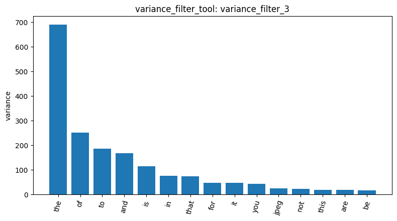
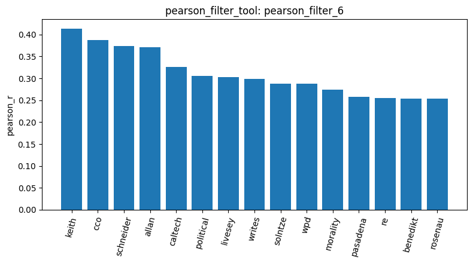
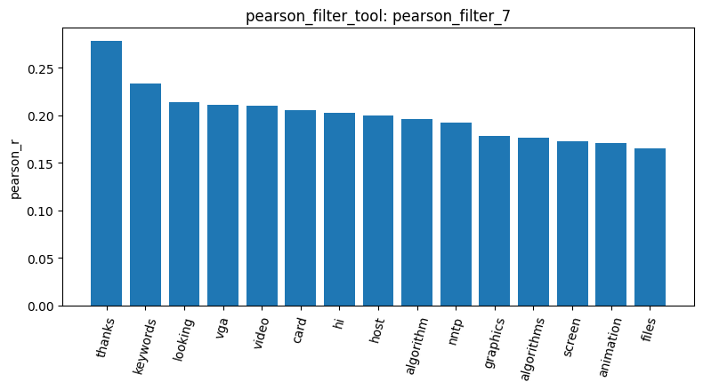
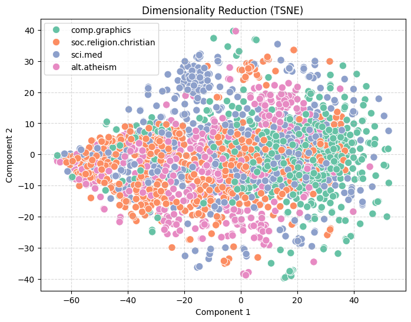
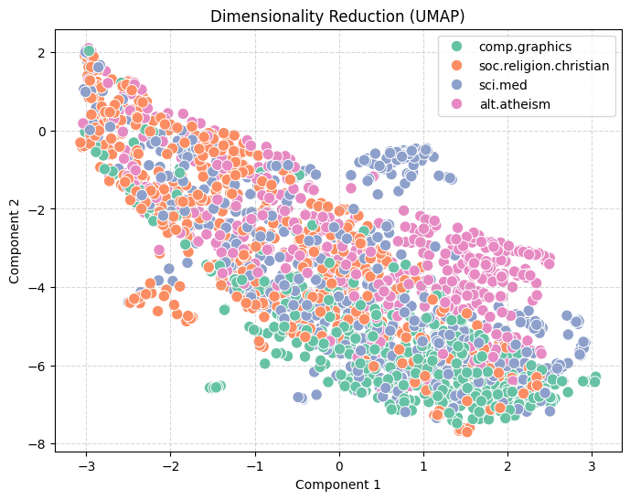

# Agentic Pipeline Report: 20 Newsgroups (four categories)

This report focuses on four categories from the 20 Newsgroups dataset: `alt.atheism`, `soc.religion.christian`, `comp.graphics`, and `sci.med`. The loaded dataset (`load_dataset_1`) comprises 2,257 documents, with a relatively balanced distribution across the categories: 480, 599, 584, and 594 documents, respectively. A document-term matrix (`dtm_2`) was constructed using unigrams, with text converted to lowercase and no limit placed on the vocabulary size. The resulting matrix has dimensions of 2,257 × 35,788, containing only 365,886 non-zero elements—a sparsity of 99.547%. This indicates that the vast majority of terms appear in only a very small number of documents, necessitating feature selection prior to further analysis.

For feature selection, this report first applied variance-based filtering using three different thresholds—0.01, 0.05, and 0.001—retaining 5,354 (`variance_filter_3`), 1,710 (`variance_filter_4`), and 17,323 (`variance_filter_5`) terms, respectively. The number of retained terms fluctuates significantly with the threshold, suggesting that the variance of most terms is concentrated within a long-tail segment characterized by very low values. As shown in Figure 1, the terms with the highest variance are primarily stop words—such as "the" (approx. 690, read from Figure 1), "of," "to," "and," and "is"—with "jpeg" being the only topical term among the top 15. Furthermore, the top 15 terms remain identical across all three thresholds, as these thresholds only remove terms with low variance (the "tail"), leaving the top-ranked terms unaffected. Since the variance of raw term frequencies largely reflects the frequency of occurrence, this method is effective for removing rare, noisy terms but fails to identify terms with high discriminative power across categories. Consequently, this report further employs a "one-vs-rest" Pearson correlation analysis. In the results for `alt.atheism` (`pearson_filter_6`, Figure 2), the highest correlation coefficients are associated with terms such as "keith" (r ≈ 0.41, read from Figure 2), "cco," "schneider," "allan," and "caltech"—mostly names of frequent posters or their affiliated institutions—while terms directly related to the subject matter, such as "political" and "morality," rank lower. In the results for `comp.graphics` (`pearson_filter_7`, Figure 3), the overall correlation coefficients are lower (peaking at r ≈ 0.28, read from Figure 3); the top-ranked terms—"thanks," "keywords," and "looking"—reflect a style of inquiry or request for help, followed by domain-specific terms like "vga," "video," "card," "graphics," "algorithm," and "animation." Unlike variance-based filtering, Pearson correlation keeps stop words out of the top positively correlated terms, although some (such as "that" and "who") appear among the most negatively correlated terms for `comp.graphics`. The resulting terms still conflate author identity, posting style, and subject content; therefore, they should not be interpreted directly as keywords representing the topic.

Regarding frequent pattern mining, this report first analyzed `comp.graphics` (`mine_patterns_8`) using TF-IDF filtering combined with the FP-Growth algorithm (with a minimum support threshold of 80). This yielded 999 patterns, with the highest support found for "lines," "subject" (584—covering every document in the category), "organization" (560), and "edu" (320)—all of which are Usenet header fields. Applying the same settings to `alt.atheism` (`mine_patterns_9`; 4,183 patterns) and `sci.med` (`mine_patterns_10`; 8,495 patterns) revealed the same set of header-related terms at the top, confirming that these are not category-specific. When switching to term-frequency-based filtering with a minimum support threshold of 9 (`mine_patterns_11`; 16,971 patterns), the header terms disappeared; however, the maximum support dropped to only 22, and the results consisted primarily of generic terms like "recently" and "wondering," with only sporadic appearances of technical terms such as "pascal" or "ram." When using the Top-K algorithm (k = 100; `mine_patterns_12`), the initial results are identical to those obtained via FP-Growth. Applying Max FP-Growth (with a minimum support of 9; `mine_patterns_13`) yields 42,818 maximal frequent itemsets; these long patterns are dominated by header-related terms, with only a few terms such as "image," "file," "graphics," and "help" appearing at the end. Overall, the choice of algorithm appears to have a limited impact on the results (although the Max FP-Growth run used a much lower minimum support than the FP-Growth run, so the two are not directly comparable); the quality of the patterns is primarily determined by the preprocessing of the vocabulary. To derive meaningful category-specific patterns, header information and email signatures should be removed.

Finally, this report projects 2,257 documents into a two-dimensional space using both t-SNE (`reduce_dimensions_14`, Figure 4) and UMAP (`reduce_dimensions_15`, Figure 5), with the random seed set to 42 in both cases. In both visualizations, documents from the `comp.graphics` category tend to cluster toward the right and bottom-right regions. In the UMAP projection, `alt.atheism` forms a distinct band on the right, `sci.med` appears as a small, isolated cluster in the upper-middle area, and `soc.religion.christian` shows significant overlap with other categories in the top-left region. Notably, while the analysis process previously suggested that `comp.graphics` formed an "independent cluster with minimal overlap with other categories," the visualizations show clear overlap between `comp.graphics`, `sci.med`, and `soc.religion.christian`, contradicting that assertion. A more cautious conclusion is that while `comp.graphics` is relatively easier to distinguish from the two religion-related categories, none of the four categories are clearly separable given the current feature representation. This aligns with the earlier finding that raw term frequencies are dominated by stop words and header-related terms, which diminishes the underlying thematic signals. Future work could involve removing headers and stop words, employing TF-IDF features, and subsequently re-performing dimensionality reduction and pattern mining to determine whether this improves category separability.

