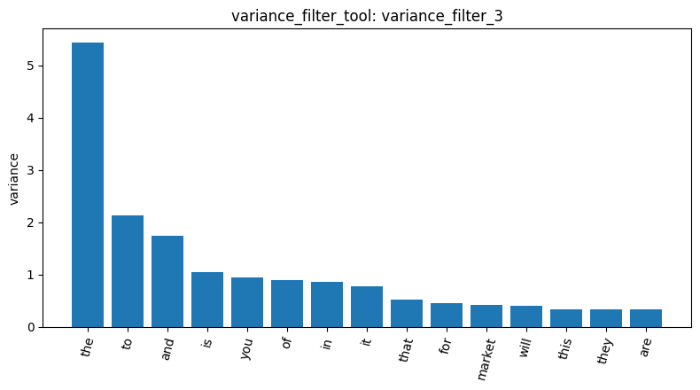
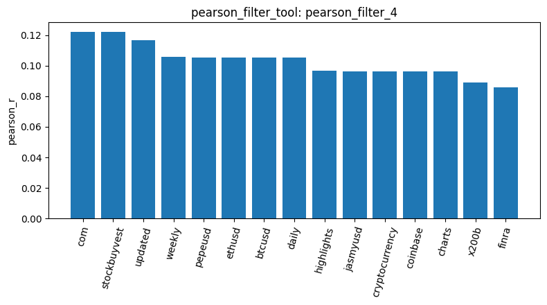
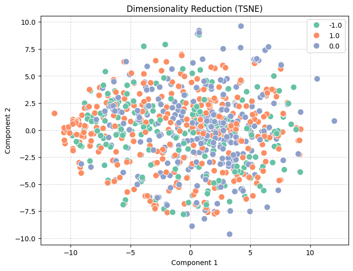
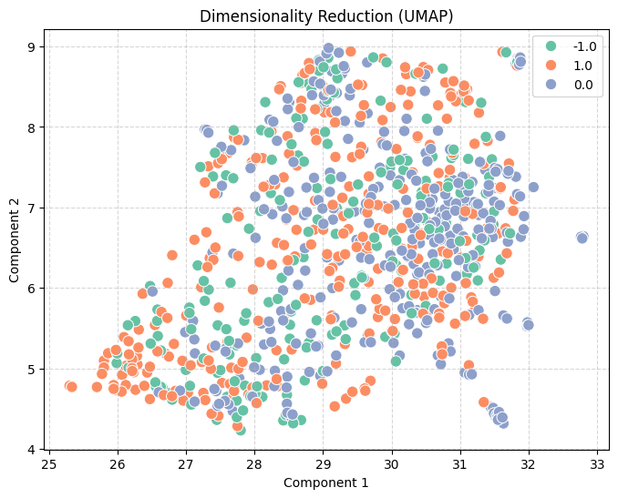

# Homework Report: Reddit Stock Sentiment

This report analyzes the Reddit stock sentiment dataset (`newdataset/Reddit-stock-sentiment.csv`), which contains 847 posts. The file provides two candidate label columns, `sentiment` and `label`, both taking the values −1.0 (negative), 0.0 (neutral), and 1.0 (positive). Because the two columns disagree on many posts, this report carries out the analysis under each labeling in turn. With `text` as the document field and `sentiment` as the label, the loaded dataset (`load_dataset_1`) comprises 331 neutral, 319 positive, and 197 negative posts. A document-term matrix (`dtm_2`) was constructed using unigrams with default settings. The resulting matrix has dimensions of 847 × 4,346 and contains only 17,193 non-zero elements—a sparsity of 99.533%. This indicates that the posts are short and share little vocabulary, necessitating feature selection prior to further analysis. This report first applied variance-based filtering with a threshold of 0.01 (`variance_filter_3`), retaining 506 terms and removing 3,840. As shown in Figure 1, the terms with the highest variance are almost exclusively stop words—such as "the" (approx. 5.4, read from Figure 1), "to" (approx. 2.1), and "and" (approx. 1.7)—with "market" being the only topical term among the top 15. Since the variance of raw term frequencies largely reflects the frequency of occurrence, this method is effective for removing rare, noisy terms but fails to identify terms that discriminate between classes.

Consequently, this report further employs a "one-vs-rest" Pearson correlation analysis for each class. In the results for the neutral class (`pearson_filter_4`, Figure 2), the highest correlation coefficients are associated with "com", "stockbuyvest", "updated", "weekly", "pepeusd", "ethusd", "btcusd", "daily", "coinbase", and "charts" (r ≈ 0.09–0.12, read from Figure 2), which suggests that the neutral class is characterized by automated price-update posts on cryptocurrency trading pairs rather than by ordinary discussion. In the results for the positive class (`pearson_filter_5`), the most positively correlated terms are "and", "good", "the", "on", and "of", while the most negatively correlated are "ethusd", "btcusd", "idiot", "bad", and "wait". Notably, while the analysis process previously suggested that "ethusd" and "btcusd" were associated with the positive and negative classes, these results show that the cryptocurrency tokens belong to the neutral class, contradicting that assertion. In the results for the negative class (`pearson_filter_6`), the leading term is "bad", followed by profanity and insults, whereas "good" and the update-post tokens are the most negatively correlated. Together with the presence of `polarity` and `subjectivity` columns in the same file, the clean separation of "good" and "bad" between the two polar classes suggests that the `sentiment` column is derived from a lexicon-based polarity score rather than from human judgment; the appearance of stop words among the positive-class terms is consistent with this, since longer posts are more likely to contain at least one polarity-bearing word.

Regarding frequent pattern mining, this report first analyzed the neutral class (`mine_patterns_7`) using TF-IDF filtering combined with the FP-Growth algorithm (with a minimum support threshold of 80). This yielded no patterns, indicating that the threshold is too high for a class of 331 short posts. This report therefore switched to the Top-K algorithm (k = 10) for the neutral (`mine_patterns_8`), positive (`mine_patterns_9`), and negative (`mine_patterns_10`) classes. All 30 patterns returned are single items, so these results describe the most frequent terms in each class rather than co-occurring word sets. In the neutral class, the highest support is found for "market" (20), "just" (18), "com", "stockbuyvest", and the bigram "com stockbuyvest" (16 each), "trump" (13), and "stock" (10). The stockbuyvest update posts thus account for only about 5% of neutral posts (16 of 331) despite dominating the Pearson ranking, and the cryptocurrency tokens from Figure 2 do not reach the Top-K list, implying that they are rare overall. The term "trump" appears in all three classes; normalized by class size, it is least frequent in neutral posts (13/331 ≈ 4%) and more frequent in positive (31/319 ≈ 10%) and negative posts (28/197 ≈ 14%). "china" likewise appears in both polar classes (support 37 in positive and 13 in negative). That prominent political entities appear on both sides suggests that the `sentiment` label does not capture the author's stance toward these entities; the separation between classes is instead carried by polarity words such as "good" in the positive class and "bad" and "tariffs" in the negative class.

This report subsequently reloaded the dataset with `label` as the class column (`load_dataset_13`), which yields a markedly different distribution: 423 neutral, 315 negative, and only 109 positive posts. Because the document text is unchanged, variance filtering produced identical results (`variance_filter_14`: 506 terms retained and 3,840 removed; plot `陳尚德_homework_plot_turn126.png` is identical to Figure 1). The Pearson rankings, however, changed substantially. In the results for the negative class (`pearson_filter_17`), the top terms are "he", "his", "will", "trump", and "fuck", while "trump" and "economy" are among the most negatively correlated terms for the neutral class (`pearson_filter_15`). In the results for the positive class (`pearson_filter_16`), the top terms are "tldr", "main", "huge", "nice", and "technology". Top-K mining corroborates this shift: "trump" is the most frequent item in the negative class (`mine_patterns_20`; 45 of 315 ≈ 14%), followed by "china" (33 ≈ 10%), whereas both terms occur in only about 5% of neutral posts (`mine_patterns_18`; 23 and 22 of 423, respectively). Neither term appears among the top ten items of the positive class (`mine_patterns_19`), whose tenth item has a support of only 6. Under the `label` column, therefore, posts concerning Trump and China lean distinctly negative, occurring two to three times more often in negative than in neutral posts, whereas under the `sentiment` column the same entities appear in both polar classes. This suggests that `label` reflects the stance a post takes toward its topic, whereas `sentiment` reflects the polarity of the words it contains.

Finally, this report projects 847 documents into a two-dimensional space using both t-SNE (`reduce_dimensions_11`, Figure 3) and UMAP (`reduce_dimensions_12`, Figure 4), with the random seed set to 42 in both cases and points colored by the `sentiment` column. In both visualizations the three classes overlap almost entirely, and no class occupies a distinct region. The UMAP projection exhibits several small, compact clusters composed mainly of neutral posts (for example, in the lower-right area), which may correspond to templated or near-duplicate posts. This aligns with the earlier finding that raw term frequencies are dominated by stop words, and that sentiment-bearing terms constitute only a small fraction of the 4,346 dimensions. Notably, the projections repeated after switching to the `label` column (`reduce_dimensions_21` and `reduce_dimensions_22`) do not constitute evidence about that column. In the tool implementation, the class labels used for coloring are updated only when `build_dtm_tool` runs, and the document-term matrix was not rebuilt after `load_dataset_13`; consequently, these two projections remain colored by `sentiment` and are visually identical to Figures 3 and 4. Future work could involve rebuilding the document-term matrix after reloading, removing stop words and the stockbuyvest template text, employing TF-IDF features, and subsequently re-performing dimensionality reduction to compare the separability of the two labelings fairly.

